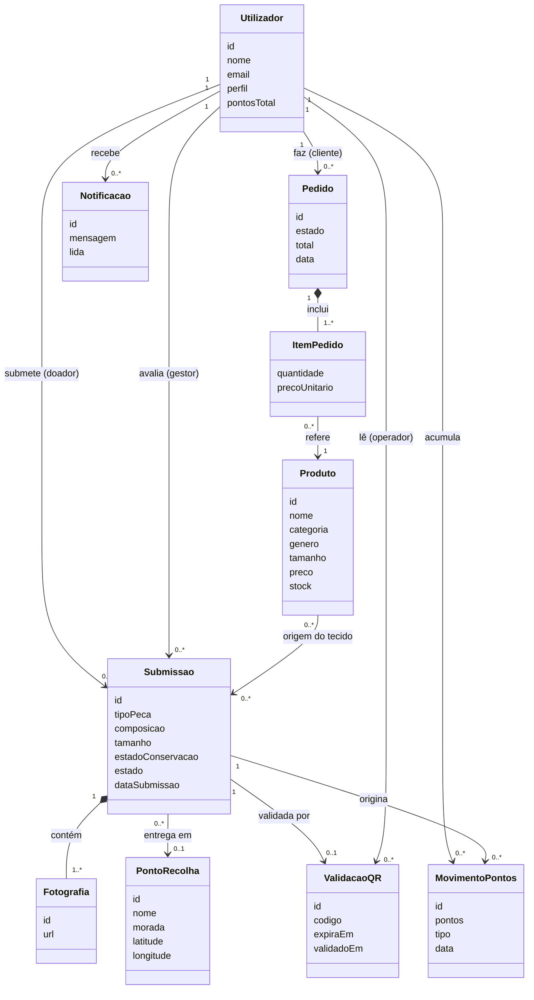
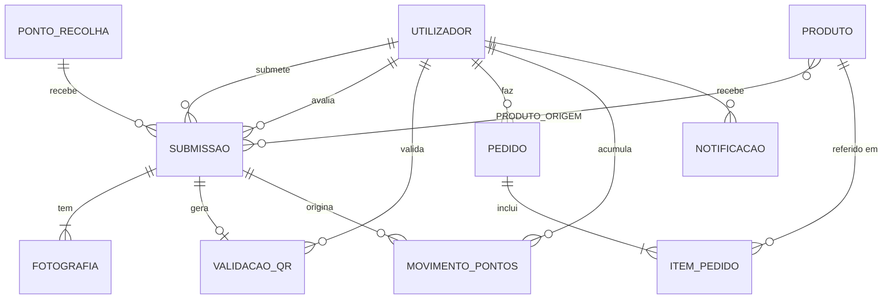

# Nuevé ReWare — Relatório Intermédio (2.ª Entrega)

**Plataforma Inteligente de Upcycling Têxtil e Comércio de Moda Sustentável**

| | |
|---|---|
| **Universidade** | Universidade Europeia — IADE |
| **Faculdade** | Faculdade de Design, Tecnologia e Comunicação (IADE) |
| **Curso** | Licenciatura em Engenharia Informática — 3.º Semestre (2026/2027) |
| **Projeto** | Nuevé ReWare |
| **Grupo** | G03 — Nuevé |
| **Repositório** | https://github.com/Alv7nS/Grupo_Nueve |
| **Data de entrega** | 06.11.2026 |

**Elementos do grupo**

| Nome | N.º de estudante |
|---|---|
| Alvin Alexandre Sacramento Dias dos Santos | 20251280 |
| Eurica Nelma Brado Costa | 20251534 |
| Cristiane Idalécia Neto Paciência | 20252623 |
| Wesley Tiago Simão Chipango | 20251556 |

**Palavras-chave:** Upcycling têxtil, moda sustentável, economia circular, aplicação móvel, Flutter, REST API, QR Code.

---

## 1. Resumo e estado do projeto

O Nuevé ReWare é uma aplicação móvel e plataforma web de economia circular no setor têxtil. O doador submete fotografias e detalhes de peças sem uso. A equipa da marca avalia o potencial de reaproveitamento, o doador entrega a peça num ponto de recolha (validação por QR Code) e os tecidos são transformados em peças novas e exclusivas, vendidas no catálogo da app.

**Estado na 2.ª entrega (protótipo alfa):**

| Componente | Estado | Notas |
|---|---|---|
| Servidor Node.js/Express (REST) | [PREENCHER: ex. endpoints de auth e submissões a funcionar] | |
| Base de dados MySQL | [PREENCHER: create.sql e populate.sql executados] | |
| App Flutter | [PREENCHER: ex. login, submissão de peça, catálogo a consumir a API] | |
| QR Code | [PREENCHER: gerado / lido / por fazer] | |
| Mockups Figma | Concluídos (ver proposta v1) | https://www.figma.com/proto/wHsidw3Zp5Ly885REkCP52/NuevéReWare?node-id=3-7528 |

**Alterações face à proposta v1:** [PREENCHER: ex. "Nenhuma alteração significativa" ou listar. Se forem significativas, entregar também `g03-proposta-v2.pdf`.]

---

## 2. Personas

### Persona 1 — Doador: Marta Oliveira

| | |
|---|---|
| **Idade / Profissão** | 34 anos, gestora de projeto |
| **Contexto** | Vive em Lisboa, tem roupa em bom estado que já não usa e não gosta de a deitar fora |
| **Utilização do telemóvel** | Android, usa a app no dia a dia, tira muitas fotografias |
| **Objetivos** | Dar utilidade à roupa de forma simples; saber o destino final das peças; ganhar descontos |
| **Frustrações** | Contentores sem transparência; Vinted exige tempo e peças "vendáveis" |
| **Citação** | "Quero que a minha roupa tenha uma segunda vida, mas sem perder tempo." |

### Persona 2 — Comprador: Rui Santos

| | |
|---|---|
| **Idade / Profissão** | 26 anos, designer gráfico |
| **Contexto** | Compra online, valoriza peças únicas e produção ética |
| **Utilização do telemóvel** | iPhone, compra várias vezes por mês por app |
| **Objetivos** | Encontrar peças exclusivas e sustentáveis a preço acessível; filtrar por tamanho, categoria e preço |
| **Frustrações** | Pouca oferta transparente; "greenwashing" |
| **Citação** | "Quero vestir algo que ninguém tem e que tenha uma história." |

### Persona 3 — Gestor/Artesão: Inês Carvalho

| | |
|---|---|
| **Idade / Profissão** | 41 anos, costureira e responsável de produção da marca |
| **Contexto** | Avalia as submissões, gere o stock de tecidos e publica novas peças |
| **Utilização do telemóvel** | Alterna entre telemóvel e computador |
| **Objetivos** | Triar rapidamente as submissões; ver fotografias com qualidade; manter o inventário organizado |
| **Frustrações** | Fotografias pouco claras; pedidos sem informação sobre o tecido |
| **Citação** | "Preciso de ver depressa se o tecido serve e dar uma resposta clara ao doador." |

> Nota: as personas são fictícias, de acordo com o briefing (dados não reais). [CONFIRMAR com a colega de Interfaces e Usabilidade se já existem personas e alinhar.]

---

## 3. Casos de utilização e guiões de teste (versão final)

### Caso de Utilização 1 (core): Submissão de peça para doação

- **Ator principal:** Doador
- **Descrição:** O doador submete fotografias e detalhes de uma peça de roupa para avaliação.
- **Pré-condição:** Utilizador registado e autenticado.
- **Guião de teste:**
  1. O doador abre a app e inicia sessão.
  2. No ecrã inicial, seleciona "Doar peça".
  3. A app pede permissão de acesso à câmara; o doador tira 2 a 4 fotografias da peça.
  4. Preenche o formulário: tipo de peça, composição do tecido, tamanho, género e estado de conservação.
  5. Carrega em "Submeter".
  6. A API valida os dados, guarda a submissão com o estado `Pendente_Avaliacao` e devolve confirmação.
  7. A app mostra a mensagem de sucesso e a submissão aparece em "As minhas doações".
- **Fluxo alternativo:** se faltarem campos obrigatórios ou fotografias, a app indica o erro e não submete.

### Caso de Utilização 2: Triagem e validação da peça

- **Ator principal:** Gestor / Administrador
- **Guião:** [COLAR da proposta v1, secção 7 (Caso 2)]

### Caso de Utilização 3: Validação da entrega física via QR Code

- **Ator principal:** Doador e Operador do Ponto de Recolha
- **Guião:** [COLAR da proposta v1, secção 7 (Caso 3)]

### Caso de Utilização 4 (opcional): Compra de peça no catálogo

- **Ator principal:** Cliente
- **Guião:**
  1. O cliente abre o catálogo e aplica filtros (género, tamanho, categoria, preço).
  2. Seleciona uma peça e consulta o detalhe, incluindo a origem do tecido.
  3. Adiciona ao carrinho e confirma o pedido.
  4. A API regista o pedido e a app mostra a confirmação.

---

## 4. Modelo de domínio e diagrama de classes (esboço)

Diagrama conceptual com foco nas entidades e nas relações entre elas.



**Estados de uma Submissão:** `Pendente_Avaliacao` → `Aprovado` → `Entregue` → `Processado`. Alternativa: `Pendente_Avaliacao` → `Rejeitado`.

> [CONFIRMAR com o colega de BD/Backend se as entidades coincidem com o que está implementado.]

---

## 5. Modelo Entidade-Relação



---

## 6. Dicionário de Dados (1.ª versão)

Legenda: **PK** chave primária · **FK** chave estrangeira · **NN** not null · **UQ** único.

### 6.1 `utilizador`

| Atributo | Tipo | Chave | Nulo | Descrição |
|---|---|---|---|---|
| id_utilizador | INT AUTO_INCREMENT | PK | NN | Identificador |
| nome | VARCHAR(100) | | NN | Nome completo |
| email | VARCHAR(150) | UQ | NN | Email de autenticação |
| password_hash | VARCHAR(255) | | NN | Hash seguro da palavra-passe (ex. bcrypt) |
| telemovel | VARCHAR(20) | | Sim | Contacto |
| perfil | ENUM('Doador','Cliente','Administrador','Operador') | | NN | Tipo de utilizador |
| pontos_total | INT DEFAULT 0 | | NN | Pontos acumulados (≥ 0) |
| consentimento_rgpd | BOOLEAN | | NN | Consentimento de tratamento de dados |
| data_registo | DATETIME | | NN | Data de criação da conta |

### 6.2 `ponto_recolha`

| Atributo | Tipo | Chave | Nulo | Descrição |
|---|---|---|---|---|
| id_ponto | INT AUTO_INCREMENT | PK | NN | Identificador |
| nome | VARCHAR(100) | | NN | Nome do parceiro |
| morada | VARCHAR(200) | | NN | Morada |
| latitude | DECIMAL(9,6) | | NN | Coordenada GPS |
| longitude | DECIMAL(9,6) | | NN | Coordenada GPS |
| horario | VARCHAR(100) | | Sim | Horário de funcionamento |
| ativo | BOOLEAN DEFAULT TRUE | | NN | Se aceita entregas |

### 6.3 `submissao`

| Atributo | Tipo | Chave | Nulo | Descrição |
|---|---|---|---|---|
| id_submissao | INT AUTO_INCREMENT | PK | NN | Identificador |
| id_doador | INT | FK → utilizador | NN | Quem submete |
| id_gestor | INT | FK → utilizador | Sim | Quem avaliou |
| id_ponto | INT | FK → ponto_recolha | Sim | Ponto de entrega (definido na aprovação) |
| tipo_peca | VARCHAR(50) | | NN | Ex.: camisa, calças, casaco |
| composicao | VARCHAR(100) | | Sim | Ex.: 100% algodão |
| tamanho | VARCHAR(10) | | Sim | Tamanho |
| genero | ENUM('Masculino','Feminino','Unissexo') | | NN | Género da peça |
| estado_conservacao | ENUM('Bom','Razoavel','Desgastado') | | NN | Estado declarado |
| descricao | TEXT | | Sim | Observações |
| estado | ENUM('Pendente_Avaliacao','Aprovado','Rejeitado','Entregue','Processado') | | NN | Estado no fluxo |
| motivo_rejeicao | VARCHAR(255) | | Sim | Preenchido se rejeitada |
| data_submissao | DATETIME | | NN | Data de criação |
| data_avaliacao | DATETIME | | Sim | Data da decisão |

### 6.4 `fotografia`

| Atributo | Tipo | Chave | Nulo | Descrição |
|---|---|---|---|---|
| id_fotografia | INT AUTO_INCREMENT | PK | NN | Identificador |
| id_submissao | INT | FK → submissao | NN | Submissão associada |
| url | VARCHAR(255) | | NN | Caminho/URL da imagem |
| ordem | TINYINT | | NN | Ordem de apresentação |

### 6.5 `validacao_qr`

| Atributo | Tipo | Chave | Nulo | Descrição |
|---|---|---|---|---|
| id_validacao | INT AUTO_INCREMENT | PK | NN | Identificador |
| id_submissao | INT | FK → submissao, UQ | NN | Submissão validada |
| codigo | VARCHAR(100) | UQ | NN | Código único do QR |
| gerado_em | DATETIME | | NN | Momento de geração |
| expira_em | DATETIME | | NN | Validade do código |
| validado_em | DATETIME | | Sim | Momento da leitura |
| id_operador | INT | FK → utilizador | Sim | Operador que leu o código |

### 6.6 `produto`

| Atributo | Tipo | Chave | Nulo | Descrição |
|---|---|---|---|---|
| id_produto | INT AUTO_INCREMENT | PK | NN | Identificador |
| nome | VARCHAR(100) | | NN | Nome da peça |
| descricao | TEXT | | Sim | Descrição |
| categoria | VARCHAR(50) | | NN | Ex.: camisas, casacos |
| genero | ENUM('Masculino','Feminino','Unissexo') | | NN | Género |
| tamanho | VARCHAR(10) | | NN | Tamanho |
| preco | DECIMAL(8,2) | | NN | Preço (> 0) |
| stock | INT | | NN | Unidades disponíveis (≥ 0) |
| imagem_url | VARCHAR(255) | | Sim | Imagem do produto |
| ativo | BOOLEAN DEFAULT TRUE | | NN | Visível no catálogo |

### 6.7 `produto_origem` (rastreabilidade)

| Atributo | Tipo | Chave | Nulo | Descrição |
|---|---|---|---|---|
| id_produto | INT | PK, FK → produto | NN | Produto criado |
| id_submissao | INT | PK, FK → submissao | NN | Peça doada que deu origem ao tecido |

### 6.8 `pedido`

| Atributo | Tipo | Chave | Nulo | Descrição |
|---|---|---|---|---|
| id_pedido | INT AUTO_INCREMENT | PK | NN | Identificador |
| id_cliente | INT | FK → utilizador | NN | Cliente |
| estado | ENUM('Pendente','Pago','Enviado','Concluido','Cancelado') | | NN | Estado do pedido |
| total | DECIMAL(10,2) | | NN | Valor total |
| desconto_pontos | DECIMAL(8,2) DEFAULT 0 | | NN | Desconto aplicado por pontos |
| data_pedido | DATETIME | | NN | Data |

### 6.9 `item_pedido`

| Atributo | Tipo | Chave | Nulo | Descrição |
|---|---|---|---|---|
| id_pedido | INT | PK, FK → pedido | NN | Pedido |
| id_produto | INT | PK, FK → produto | NN | Produto |
| quantidade | INT | | NN | Quantidade (> 0) |
| preco_unitario | DECIMAL(8,2) | | NN | Preço no momento da compra |

### 6.10 `movimento_pontos`

| Atributo | Tipo | Chave | Nulo | Descrição |
|---|---|---|---|---|
| id_movimento | INT AUTO_INCREMENT | PK | NN | Identificador |
| id_utilizador | INT | FK → utilizador | NN | Titular dos pontos |
| id_submissao | INT | FK → submissao | Sim | Doação que originou os pontos |
| pontos | INT | | NN | Positivo (ganho) ou negativo (gasto) |
| tipo | ENUM('Doacao','Resgate','Ajuste') | | NN | Motivo |
| data_movimento | DATETIME | | NN | Data |

### 6.11 `notificacao`

| Atributo | Tipo | Chave | Nulo | Descrição |
|---|---|---|---|---|
| id_notificacao | INT AUTO_INCREMENT | PK | NN | Identificador |
| id_utilizador | INT | FK → utilizador | NN | Destinatário |
| mensagem | VARCHAR(255) | | NN | Texto |
| lida | BOOLEAN DEFAULT FALSE | | NN | Estado de leitura |
| data_envio | DATETIME | | NN | Data |

> [CONFIRMAR: nomes de tabelas, tipos e restrições têm de ser iguais aos do `create.sql`. Se a BD já foi criada, ajustar este dicionário ao que existe.]

---

## 7. Guia de Dados (esboço da BD exemplo)

Os dados de exemplo são fictícios e simulam situações reais de utilização.

| Tabela | N.º de registos (alvo) | Descrição dos dados de exemplo |
|---|---|---|
| utilizador | [PREENCHER: ~12] | 5 doadores, 4 clientes, 2 gestores, 1 operador |
| ponto_recolha | [PREENCHER: ~5] | Pontos em Lisboa e arredores, com coordenadas |
| submissao | [PREENCHER: ~30] | Distribuídas por todos os estados, de vários doadores |
| fotografia | [PREENCHER: ~60] | 2 por submissão |
| validacao_qr | [PREENCHER: ~10] | Códigos validados, pendentes e expirados |
| produto | [PREENCHER: ~20] | Masculino/feminino, várias categorias e tamanhos |
| produto_origem | [PREENCHER: ~20] | Ligação produto ↔ peças doadas |
| pedido / item_pedido | [PREENCHER: ~15 / ~25] | Pedidos em vários estados |
| movimento_pontos | [PREENCHER: ~25] | Ganhos por doação e resgates |
| notificacao | [PREENCHER: ~30] | Aprovação, rejeição, entrega validada |

**Situações simuladas:** doador com várias doações; submissão rejeitada com motivo; QR expirado; produto criado a partir de duas peças doadas; cliente que usa pontos como desconto. [CONFIRMAR com `populate.sql`.]

---

## 8. Documentação REST (1.ª versão)

Formato baseado em https://bocoup.com/blog/documenting-your-api.
**URL base:** `http://localhost:3000/api` [CONFIRMAR porta e prefixo]
**Formato:** JSON. **Autenticação:** `Authorization: Bearer <token>` (exceto registo e login).

### Resumo dos endpoints

| Método | URL | Descrição | Perfil |
|---|---|---|---|
| POST | `/auth/register` | Registar utilizador | Público |
| POST | `/auth/login` | Autenticar | Público |
| POST | `/submissoes` | Criar submissão de peça | Doador |
| GET | `/submissoes` | Listar (as minhas ou, para gestor, todas/por estado) | Doador, Admin |
| GET | `/submissoes/:id` | Detalhe de uma submissão | Doador, Admin |
| PUT | `/submissoes/:id/aprovar` | Aprovar peça | Admin |
| PUT | `/submissoes/:id/rejeitar` | Rejeitar peça | Admin |
| POST | `/submissoes/:id/qr` | Gerar QR Code da entrega | Doador |
| POST | `/validacoes/qr` | Validar QR Code lido | Operador |
| GET | `/produtos` | Catálogo com filtros | Público |
| GET | `/produtos/:id` | Detalhe de produto | Público |
| POST | `/pedidos` | Criar pedido | Cliente |
| GET | `/pedidos` | Listar os meus pedidos | Cliente |
| GET | `/utilizadores/me/pontos` | Saldo e movimentos de pontos | Doador |
| GET | `/pontos-recolha` | Listar pontos de recolha | Autenticado |
| GET | `/notificacoes` | Listar notificações | Autenticado |

### 8.1 Login

**POST** `/auth/login`

* **Data Params (JSON):** `email` (string, obrigatório), `password` (string, obrigatório)
* **Success Response:**
  * **Code:** 200
  * **Content:**
    ```json
    { "token": "eyJhbGciOi...", "utilizador": { "id": 1, "nome": "Marta Oliveira", "perfil": "Doador" } }
    ```
* **Error Response:**
  * **Code:** 401 · **Content:** `{ "erro": "Credenciais inválidas" }`
  * **Code:** 400 · **Content:** `{ "erro": "Email e password são obrigatórios" }`
* **Sample Call:**
  ```bash
  curl -X POST http://localhost:3000/api/auth/login \
    -H "Content-Type: application/json" \
    -d '{"email":"marta@exemplo.pt","password":"Teste123!"}'
  ```
* **Notes:** a password é comparada com o hash guardado (RNF02).

### 8.2 Registo

**POST** `/auth/register`

* **Data Params (JSON):** `nome`, `email`, `password`, `perfil` (`Doador` ou `Cliente`), `consentimento_rgpd` (true)
* **Success Response:** Code 201 · `{ "id": 12, "nome": "Rui Santos", "perfil": "Cliente" }`
* **Error Response:**
  * Code 409 · `{ "erro": "Email já registado" }`
  * Code 400 · `{ "erro": "Consentimento RGPD obrigatório" }`
* **Sample Call:**
  ```bash
  curl -X POST http://localhost:3000/api/auth/register \
    -H "Content-Type: application/json" \
    -d '{"nome":"Rui Santos","email":"rui@exemplo.pt","password":"Teste123!","perfil":"Cliente","consentimento_rgpd":true}'
  ```

### 8.3 Criar submissão

**POST** `/submissoes` (Doador autenticado)

* **Data Params (multipart/form-data):** `tipo_peca`, `genero`, `estado_conservacao` (obrigatórios); `composicao`, `tamanho`, `descricao` (opcionais); `fotografias` (1 a 4 ficheiros JPEG/PNG)
* **Success Response:**
  * **Code:** 201
  * **Content:**
    ```json
    { "id_submissao": 31, "estado": "Pendente_Avaliacao", "fotografias": 3 }
    ```
* **Error Response:**
  * Code 400 · `{ "erro": "Pelo menos uma fotografia é obrigatória" }`
  * Code 401 · `{ "erro": "Não autenticado" }`
* **Sample Call:**
  ```bash
  curl -X POST http://localhost:3000/api/submissoes \
    -H "Authorization: Bearer <token>" \
    -F "tipo_peca=casaco" -F "genero=Feminino" -F "estado_conservacao=Bom" \
    -F "fotografias=@foto1.jpg"
  ```

### 8.4 Aprovar submissão

**PUT** `/submissoes/:id/aprovar` (Administrador)

* **URL Params:** `id` (inteiro, obrigatório)
* **Data Params (JSON):** `id_ponto` (inteiro, obrigatório)
* **Success Response:** Code 200 · `{ "id_submissao": 31, "estado": "Aprovado", "id_ponto": 2 }`
* **Error Response:**
  * Code 404 · `{ "erro": "Submissão não encontrada" }`
  * Code 409 · `{ "erro": "A submissão não está em Pendente_Avaliacao" }`
  * Code 403 · `{ "erro": "Sem permissões" }`
* **Sample Call:**
  ```bash
  curl -X PUT http://localhost:3000/api/submissoes/31/aprovar \
    -H "Authorization: Bearer <token>" -H "Content-Type: application/json" \
    -d '{"id_ponto":2}'
  ```
* **Notes:** cria uma notificação para o doador com as instruções de entrega.

### 8.5 Validar QR Code

**POST** `/validacoes/qr` (Operador)

* **Data Params (JSON):** `codigo` (string, obrigatório)
* **Success Response:** Code 200 · `{ "id_submissao": 31, "estado": "Entregue", "pontos_atribuidos": 10 }`
* **Error Response:**
  * Code 404 · `{ "erro": "Código inválido" }`
  * Code 410 · `{ "erro": "Código expirado" }`
  * Code 409 · `{ "erro": "Código já utilizado" }`
* **Sample Call:**
  ```bash
  curl -X POST http://localhost:3000/api/validacoes/qr \
    -H "Authorization: Bearer <token>" -H "Content-Type: application/json" \
    -d '{"codigo":"NRW-7F3A9C21"}'
  ```
* **Notes:** altera o estado para `Entregue` e regista um `movimento_pontos` (tipo `Doacao`). O número de pontos por doação é [DEFINIR].

### 8.6 Listar produtos (catálogo)

**GET** `/produtos`

* **URL Params (query, opcionais):** `genero`, `tamanho`, `categoria`, `preco_min`, `preco_max`
* **Success Response:**
  * **Code:** 200
  * **Content:**
    ```json
    [ { "id_produto": 5, "nome": "Camisa Patchwork", "genero": "Masculino", "tamanho": "M", "preco": 39.90, "stock": 2 } ]
    ```
* **Error Response:** Code 400 · `{ "erro": "Parâmetros inválidos" }`
* **Sample Call:**
  ```bash
  curl "http://localhost:3000/api/produtos?genero=Masculino&tamanho=M&preco_max=50"
  ```
* **Notes:** objetivo de resposta inferior a 2 s (RNF01).

> Os restantes endpoints seguem o mesmo formato. [PREENCHER com a pessoa do backend: acrescentar os que forem implementados e corrigir URLs/códigos reais.]

---

## 9. Requisitos (atualização)

Mantêm-se os RF01–RF05 e RNF01–RNF04 da proposta v1. [PREENCHER: acrescentar ou alterar se algo mudou.]

| ID | Requisito | Estado |
|---|---|---|
| RF01 | Registo e autenticação | [PREENCHER] |
| RF02 | Captura e envio de imagens | [PREENCHER] |
| RF03 | Catálogo com filtros | [PREENCHER] |
| RF04 | Gerar e ler QR Codes | [PREENCHER] |
| RF05 | Pontos/descontos | [PREENCHER] |

---

## 10. Arquitetura e tecnologias

```
App móvel (Flutter/Dart)
        │  HTTP/REST (JSON)
Servidor backend (Node.js/Express)
        │  SQL (driver MySQL)
Base de dados MySQL
```

| Camada | Tecnologia |
|---|---|
| Design | Figma |
| App móvel | Flutter / Dart |
| Backend | Node.js, Express.js |
| Base de dados | MySQL |
| Gestão do projeto | Git, GitHub, GitHub Projects |

**Arquitetura MVC (briefing):** [PREENCHER: descrever a organização em pastas/módulos, ex. `models/`, `controllers/`, `routes/`, `services/` no servidor, e `models/`, `views/`, `services/` na app Flutter.]

---

## 11. Plano de trabalhos atualizado

### Distribuição de tarefas

| Tarefa | Responsável | Estado |
|---|---|---|
| Relatório e documentação | [PREENCHER] | |
| Base de dados (ER, create/populate/queries) | [PREENCHER] | |
| Servidor Node.js e documentação REST | [PREENCHER] | |
| App Flutter | [PREENCHER] | |
| Mockups Figma / usabilidade | [PREENCHER] | |
| Método numérico (Matemática Discreta) | [PREENCHER] | |

### Gantt

[PREENCHER: colar o Gantt da proposta v1 atualizado com o progresso real até à semana 9 e o planeamento das semanas 10 a 14.]

---

## 12. Ficheiros entregues com esta versão

| Item | Localização no repositório |
|---|---|
| create.sql | `[PREENCHER: ex. 05_Artefactos/bd/create.sql]` |
| populate.sql | `[PREENCHER]` |
| queries.sql | `[PREENCHER]` |
| Código do servidor | `[PREENCHER]` |
| Código da app Flutter | `[PREENCHER]` |
| BD Report | `[PREENCHER]` |
| Memória descritiva | `01_Memoria_Descritiva/memoria.md` |

---

## 13. Bibliografia

- BOCOUP. *Documenting Your API*. https://bocoup.com/blog/documenting-your-api
- FLUTTER DOCS. *Flutter Documentation*. https://docs.flutter.dev/
- MYSQL. *MySQL 8.0 Reference Manual*. Oracle, 2026. https://dev.mysql.com/doc/
- PRESSMAN, Roger S. *Engenharia de Software: Uma Abordagem Profissional*. 8.ª ed. McGraw-Hill, 2016.
